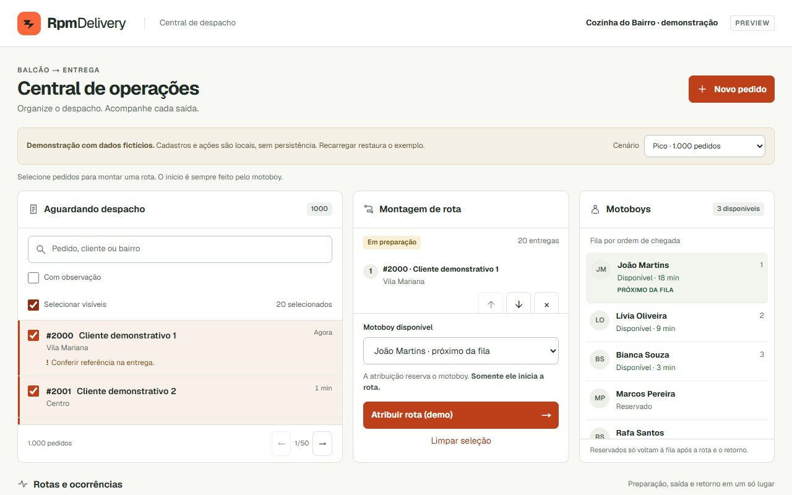
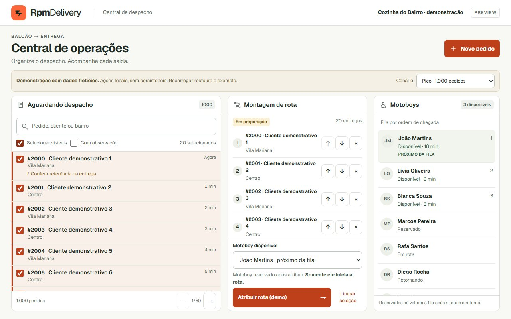
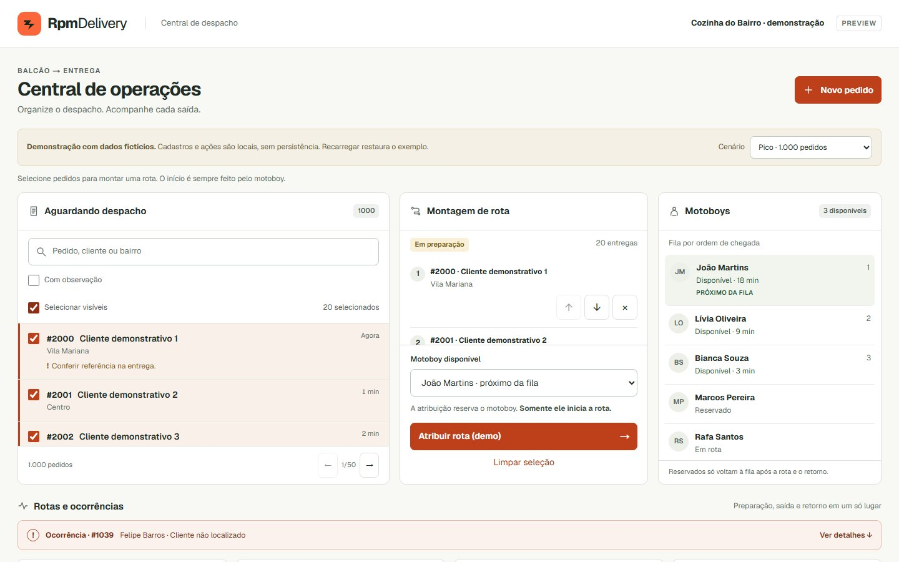
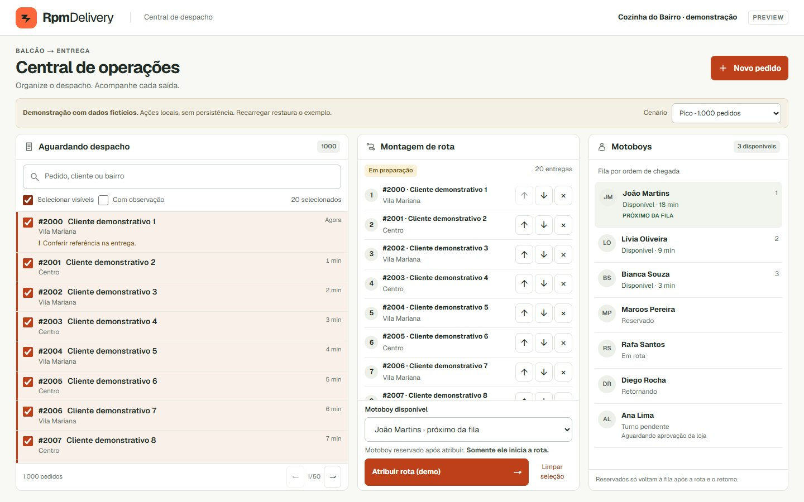
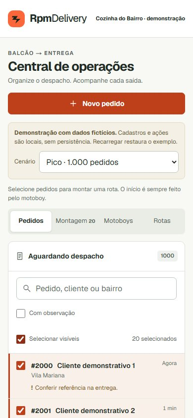
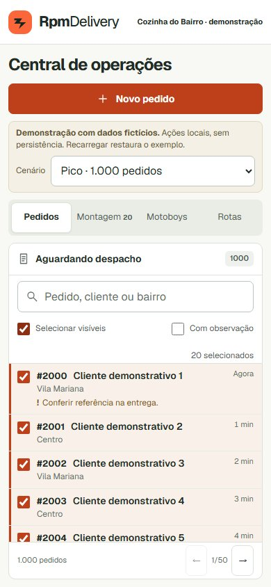
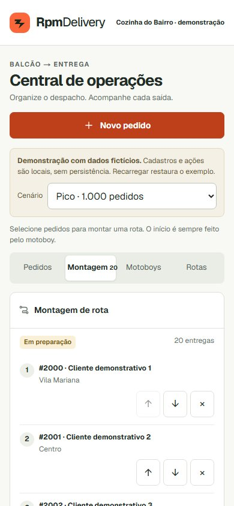
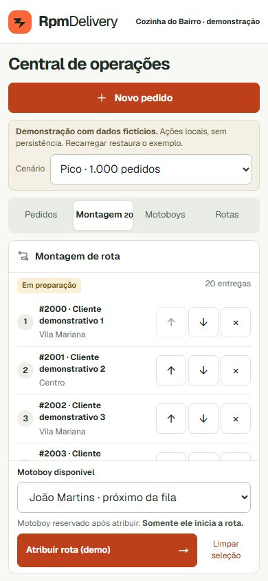

# Refinamento de densidade — PR #10

Comparação com o HEAD anterior `bc212734efcdb7b2473e32ab62f5a5d44e97d67b`, conforme a revisão UX registrada na PR. Cenário reproduzível: `/preview/operacao?scenario=busy`, selecionar os 20 pedidos da primeira página; no mobile, alternar Pedidos/Montagem. Mesmos dados, seleção, viewport, DPR 1 e rolagem da página/listas no início em todas as capturas.

Uma linha completa inclui todos os seus textos e controles, dentro da lista **e** do viewport. As contagens são capacidades observadas nesse conjunto de dados, não garantias para nomes/observações de qualquer tamanho. Textos essenciais continuam quebrando linhas sem truncamento.

| Viewport | Pedidos antes → depois | Paradas antes → depois | Área visível de pedidos (px) | Área visível de paradas (px) |
| --- | --- | --- | --- | --- |
| 1280×800 | 2 → 6 | 0 → 3 | 168 → 350 | 92 → 275 |
| 1440×900 | 2 → 8 | 1 → 7 | 196 → 450 | 138 → 393 |
| 390×844, abas separadas | 1 → 4 | 2 → 3 | 130 → 255 | 250 → 236 |

No mobile, a área de paradas é ligeiramente menor porque agora o seletor e a atribuição permanecem visíveis junto à lista, sem precisar passar pelas 20 paradas. A densidade das linhas ainda permite mais paradas completas. Em telas baixas e com mensagens longas, a página continua rolável; não há elementos sobrepostos.

| Antes | Depois | Motivo |
| --- | --- | --- |
| Painéis `clamp(440px, 52vh, 552px)` | Altura desktop `clamp(520px, calc(100dvh - 260px), 960px)` | Aproveitar altura de trabalho; rotas continuam abaixo, acessíveis pela página |
| Cabeçalho de 60px, filtro/seleção separados | Cabeçalho de 46px, filtro junto à seleção, resumo filtrado/total | Reduzir faixas sem remover busca nem filtros |
| Rodapé mesmo sem paginação | Rodapé somente quando há mais de uma página; indicação de edição separada | Devolver espaço à lista mantendo contexto |
| Linhas de pedidos com padding de 12px e notas afastadas | Padding de 7px, notas próximas, altura mínima de 44px | Mostrar código, cliente, bairro, espera e observação inteira |
| Ações ocupam uma segunda linha em toda parada | Ações ao lado a partir de 330px de largura do painel | Preservar fallback em 320px e textos longos com quebra de linha |
| Área de atribuição com ações empilhadas e texto extenso | Atribuir/limpar lado a lado e instrução curta | Manter reserva e início manual explícitos |
| Introdução mobile com blocos redundantes e lista longa antes do CTA | Introdução curta, aviso de demonstração mantido, lista com rolagem independente | Acesso contínuo ao motoboy e atribuição |

## Evidência visual

Desktop 1280×800:

| Antes | Depois |
| --- | --- |
|  |  |

Desktop 1440×900:

| Antes | Depois |
| --- | --- |
|  |  |

Mobile 390×844:

| Área | Antes | Depois |
| --- | --- | --- |
| Pedidos |  |  |
| Montagem |  |  |

Medições brutas: `screenshots/density/before-measurements.json` e `after-measurements.json`. Capturas contêm somente dados fictícios.

## Validação e limites

- Skills: `emil-design-eng`, `mobile-native`, `break-ui`, `rpmdelivery-qa`, com revisão React dos componentes alterados.
- E2E protege ganho mínimo de densidade, atribuição no viewport mobile, alvos de toque ≥44×44px, ausência de rolagem horizontal em 320/390px, reordenação por teclado, rodapé condicional, nomes e códigos longos.
- A medição E2E aguarda `document.fonts.ready`. Linhas e rodapé mantêm margem adicional após a primeira execução Linux mostrar a terceira parada cortada, sem reduzir o mínimo exigido de três paradas completas.
- Cenários existentes preservados: vazio, um pedido, pico de 1.000, nomes extensos, identificador longo, CJK/árabe, notas de alergia e HTML literal. Campos mantêm os limites e fixtures anteriores; nenhuma informação é apagada para ganhar espaço.
- O fluxo completo continua coberto: PREPARING/reserva, edição, início manual pelo motoboy, ON_ROUTE bloqueado, ocorrência, RETURNING e retorno ao fim da fila. Nenhuma regra do reducer mudou.
- Navegador integrado: desktop/mobile, seleção e reserva, teclado, textos longos e fallback 320px; console e rede sem erros inesperados na captura.
- Não há frame Figma aprovado. Não foi possível validar aparelho físico, teclado virtual ou zoom nativo de 200%; reflow 640px continua coberto pelos E2E.
- Sem mudanças de banco, autenticação, dados reais, tracking, notificações, dependências, secrets ou produção. Alterações anteriores do checkout principal preservadas.
