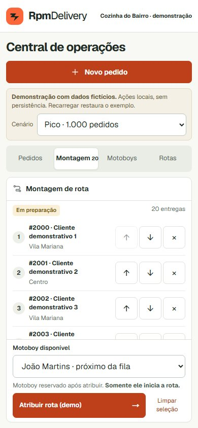
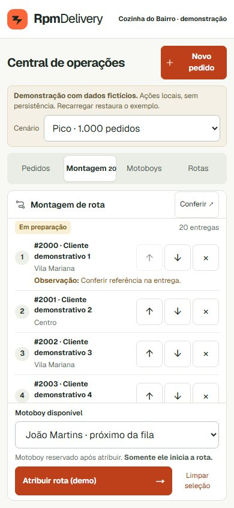
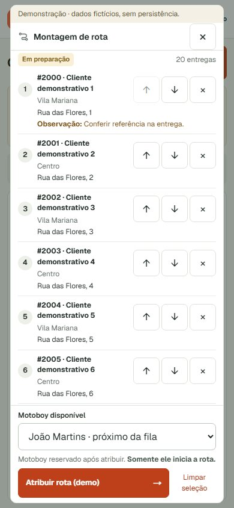
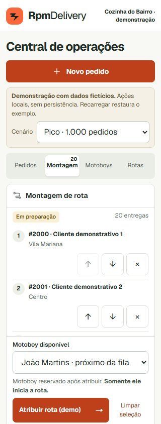
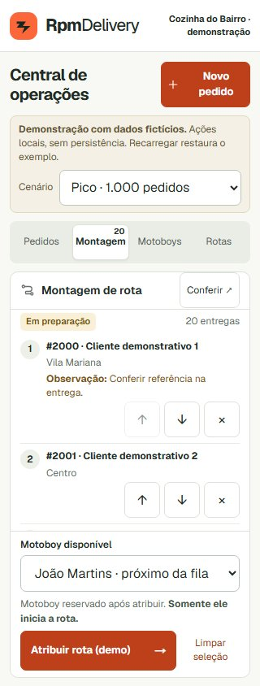
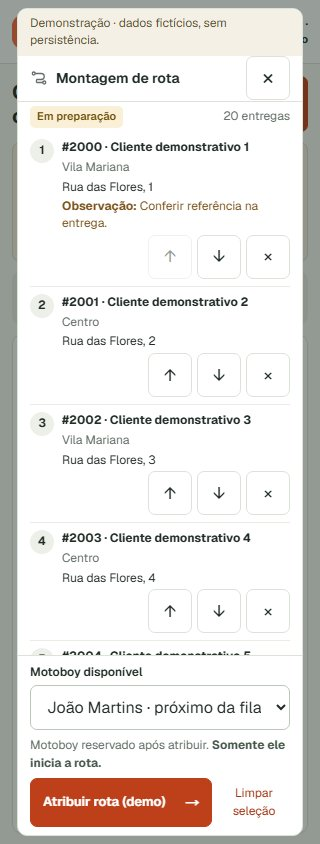
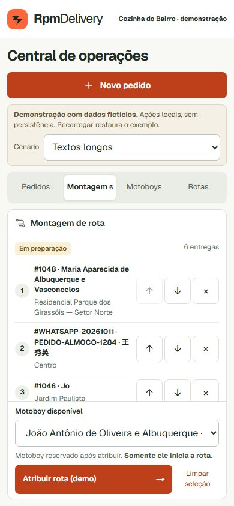
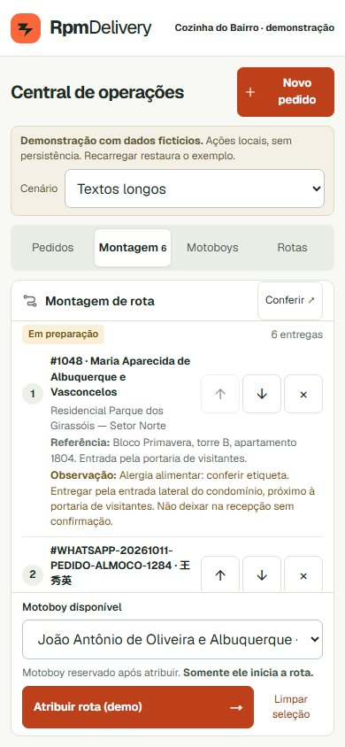
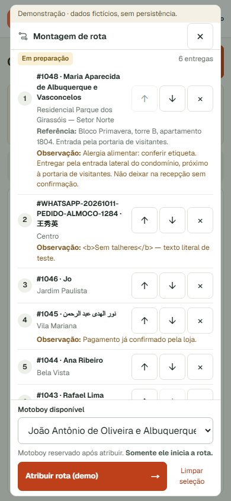

# PR #10 — observações e conferência de rotas

## Integração e escopo

`origin/main` recebeu a PR #11 no squash `a550ce5ac987f7b90275e8de22d7c9416fb42d8d`. A integração na branch existente `feat/restaurant-operations-dashboard` foi feita por merge, sem conflitos, sem reescrever histórico e sem alterar o checkout principal. O commit de integração é `d1db791` e preserva o Visual Critic e sua documentação.

Na consulta inicial, GitHub retornou `MERGEABLE/CLEAN` e o CI anterior aprovado; o bloqueio histórico não foi reproduzido. A branch ainda não incluía a nova main. A API de regras da branch retornou 403 por limitação do plano do repositório, portanto não foi atribuída uma causa não comprovada ao aviso. O estado final, depois do push, está registrado na PR.

Esta alteração é exclusivamente do protótipo visual. PREPARING/reserva, edição, início manual pelo motoboy, ON_ROUTE bloqueado, ocorrência, RETURNING e retorno ao fim da fila continuam no reducer anterior. Não há CRUD, novas transições reais, sons, janelas de ocorrências, notificações, migrations, Supabase, autenticação, dependências ou produção.

## Os dois P2

| Antes | Depois | Benefício |
| --- | --- | --- |
| Observações só em Pedidos | Observação integral e complemento/referência também em cada parada | Conferir alergias, portaria e instruções antes da atribuição, sem alternar abas |
| Janela pequena para conferir muitas entregas no mobile | Cabeçalho compacto e botão “Conferir” abre montagem ampliada, com a mesma seleção e sequência | Mais paradas visíveis, mantendo motoboy/atribuição acessíveis |

As instruções quebram linhas naturalmente, sem ellipsis, line-clamp ou ocultação. Linhas sem instruções opcionais não reservam espaço para elas. Em 320px, controles podem ficar abaixo da identificação para preservar leitura e toque ≥44×44px. A ampliação usa um dialog nativo: fundo inerte, foco inicial em Fechar, Escape e retorno de foco ao botão Conferir. Ao atribuir pela conferência, o dialog fecha e a área Rotas recebe o foco no mobile; a rota continua PREPARING.

Só existe uma instância dos controles da montagem por vez. O modo ampliado usa os mesmos props, callbacks e seleção local, sem duplicar estado operacional. O aviso “Demonstração · dados fictícios, sem persistência” permanece visível na conferência.

A primeira revisão nativa independente confirmou os dois P2 nas capturas e encontrou outro P2: a falta de rua/número para conferir o destino. O Builder acrescentou o endereço integral no modo ampliado, usando a largura disponível antes da referência/observação. O compacto mantém o resumo e acesso explícito por Conferir. O [relatório inicial](reviews/pr-10-visual-critic-p2.md) permanece registrado com evidências imutáveis e limitações.

## Comparação mensurável

Antes: UI do HEAD `7fe01d6aaeb326e4d2869e226d06d57d451861ae` (o merge da main não mudou produto). Mesmos fixtures, viewport, DPR 1, 20 pedidos selecionados do cenário `busy`, fontes carregadas e listas/página na rolagem inicial. Mobile usa toque emulado. Uma parada completa inclui textos, instruções, controles e limite inferior da linha, dentro da lista e do viewport.

| Viewport | Paradas compactas antes | Paradas compactas depois, com observações | Paradas em Conferir | Área da sequência antes → compacta → ampliada (px) |
| --- | --- | --- | --- | --- |
| 1280×800 | 3 | 3 | 6 | 275 → 283 → 516 |
| 1440×900 | 7 | 7 | 8 | 393 → 401 → 616 |
| 320×844 | 2 | 2 | 4 | 218 → 242 → 523 |
| 375×844 | 3 | 3 | 5 | 218 → 258 → 541 |
| 390×844 | 3 | 3 | 6 | 236 → 276 → 559 |

O ganho ampliado exige tocar em Conferir; não é atribuído indevidamente à montagem compacta. Contagens dependem dos textos do dataset. No cenário `worst`, os novos complementos, endereços e notas extensas aumentam a altura das linhas: preferiu-se preservar toda informação a esconder instruções para aumentar contagens. Na conferência ampliada final, o cenário longo mostra duas paradas completas em 320px e três em 375/390px; a sequência permanece rolável. Seletor e CTA estão dentro do viewport em todas as capturas, sem overflow horizontal.

Após a observação do Critic sobre linhas aparentemente completas junto à borda, a medição passou a registrar `listTop/listBottom` e `rowBounds` com coordenadas fracionárias. `completeStops` exige também que o limite inferior inteiro da linha (borda/padding) esteja dentro da área; conteúdo legível com poucos pixels de padding cortados não é contado. `totalNotes` é quantidade montada, enquanto `visibleNotes` conta apenas notas integralmente visíveis. Não são contagens de todas as informações da rota visíveis ao mesmo tempo.

Dados brutos: [antes](screenshots/p2-final/before-measurements.json) e [depois](screenshots/p2-final/after-measurements.json). Há capturas do cenário de pico e textos longos nos cinco tamanhos, com montagem compacta antes/depois e conferência ampliada depois, somente dados fictícios.

| Exemplo | Antes | Depois compacto | Conferência |
| --- | --- | --- | --- |
| Pico 390px |  |  |  |
| Pico 320px |  |  |  |
| Textos longos 390px |  |  |  |

## Validação

Os E2E cobrem observação integral, referência de portaria, alergia, controles de 44px em 320/375/390, abertura pelo teclado, foco, Escape, preservação da sequência, ganho de capacidade e atribuição PREPARING pelo modo ampliado. As verificações operacionais anteriores permanecem.

Foi necessário alinhar o ignore do ESLint aos artefatos já ignorados pelo Git: `playwright-report/**` e `test-results/**`. Uma falha intermediária gerou JS externo do relatório, que o lint tentava analisar como código do projeto. Nenhuma regra de lint da aplicação foi relaxada e nenhuma evidência foi apagada.

QA do Builder usa `emil-design-eng`, `mobile-native`, `break-ui`, `rpmdelivery-qa` e revisão React. O Visual Critic é invocado nativamente em uma sessão nova, read-only, após a implementação/validação; seu relatório e limitações são entregues separadamente, sem correção pelo próprio agente.

Não existe frame Figma aprovado. A identidade do raio foi preservada. Emulação não valida hardware físico, teclado virtual, gestos, safe areas ou zoom nativo de 200%.

Resultados locais finais: verify aprovado (lint, typegen/TypeScript e build), 11 unitários aprovados, SQL/PGlite local aprovado e audit de produção com zero vulnerabilidades. O QA integrado confirmou 320/375/390 e desktop, observações, reordenação, foco/Escape e atribuição PREPARING; captura de console/network sem erros inesperados e sem truncamento. Resultados de Playwright, segunda revisão independente e CI são registrados na entrega/PR, com o HEAD correspondente.

Playwright final: `npm run test:e2e -- --workers=1 --retries=0`, 54 aprovados (1,8min), sem retries. A [segunda revisão nativa independente](reviews/pr-10-visual-critic-final.md), no HEAD de implementação `a2713fd37be370231696a6ab5ea581f76703d901`, não encontrou novos achados nas capturas inspecionadas e confirmou as soluções dos três P2. Recalculou todas as contagens atuais com os limites fracionários fornecidos. O navegador do Critic estava indisponível/bloqueado: sua cobertura foi capturas, métricas e fontes; interações e console/network são evidências do Builder/E2E, não inspeção independente. CI e mergeabilidade finais estão registrados na PR após o push.

A primeira execução CI final (`38188793881`, HEAD `2f79341`) aprovou todos os gates anteriores e 52 E2E, mas o novo teste de densidade falhou nos dois perfis: exigia exatamente um ganho mínimo de três paradas, enquanto a renderização Linux mostrou cinco paradas completas contra três compactas (Windows mostrou seis). A [captura do runner](screenshots/p2-final/ci-busy-390-expanded.png) confirma endereço/controles/rodapé e a sexta parada parcialmente visível. A falha repetiu-se nos retries, sem recuperação; não foi tratada como flaky nem silenciada.

O teste foi corrigido para aguardar fontes e comprovar duas propriedades portáveis: ganho de pelo menos duas paradas completas e aumento de área útil de pelo menos 80%, além das verificações já existentes de destino integral, toque, seletor/CTA e PREPARING. Isso preserva o objetivo de ganho significativo sem exigir contagem idêntica entre plataformas. Nenhum CSS/produto, CI ou retry global mudou após a revisão do Critic; as contagens comparativas desta página continuam referentes às capturas Windows identificadas, não são promessa universal por sistema operacional.
